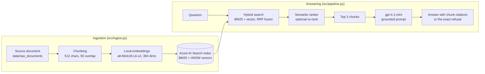
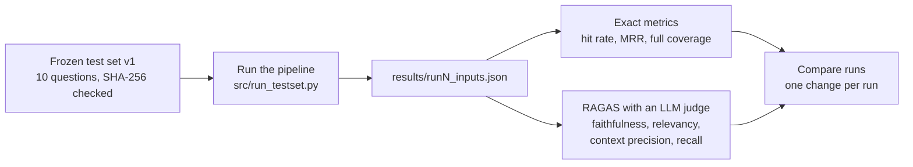

# azure-rag-ragas-eval

A small retrieval-augmented generation (RAG) pipeline on Azure, with an evaluation harness that answers the question most RAG demos skip: **did this change actually help?**

**Result:** adding Azure AI Search's semantic ranker raised MRR from 0.79 to 1.00 and RAGAS context precision from 0.65 to 0.79 on a frozen 10-question test set, with no loss in faithfulness.

Hybrid search (keywords + vectors) with an optional semantic ranker, answers grounded in retrieved chunks with citations and an exact refusal sentence, a frozen test set, and two kinds of metrics: exact retrieval metrics (hit rate, MRR, full coverage) and RAGAS with an LLM judge. Two runs are compared one change at a time, and the decision is backed by numbers.

> **About the data.** The source document is synthetic: it was generated with an AI assistant for this project, modelled on the structure of standard patient-information leaflets. **Fictoprazole is a fictional drug.** This is not medical advice.

## The problem and the approach

Language models answer confidently even when they don't know. For question answering over documents that is a hallucination risk. This project constrains the model instead of trusting it:

1. **Retrieve** the most relevant chunks of the document (hybrid search, top 3).
2. **Ground** the answer: the model may only use those chunks, must cite them as `[chunk N]`, and must reply exactly `I don't know based on the provided documents.` when the answer is not there.
3. **Measure**, don't guess: run a frozen 10-question test set, score it, change one thing, run it again, compare.

## Architecture





## Tech stack

| Layer | Choice |
|---|---|
| Chunking | LangChain `RecursiveCharacterTextSplitter`, 512 characters, 50 overlap |
| Embeddings | `all-MiniLM-L6-v2` (384 dimensions), computed locally |
| Search | Azure AI Search (Free tier): BM25 + HNSW vector search fused with RRF, optional semantic ranker |
| Generation | Azure OpenAI `gpt-4.1-mini` (Global Standard deployment, model version pinned), temperature 0 |
| Evaluation | RAGAS 0.4.3 (judge: same `gpt-4.1-mini` deployment, temperature 0) + exact metrics in plain Python |
| Tests | pytest, fully offline (no Azure calls) |

## Quick start

Requires Python 3.11.

```bash
git clone https://github.com/Vatan15/azure-rag-ragas-eval.git
cd azure-rag-ragas-eval
python -m venv .venv
.venv\Scripts\Activate.ps1        # Windows PowerShell. macOS/Linux: source .venv/bin/activate
pip install -r requirements.txt
```

**Without any Azure account** (offline, free):

```bash
python -m pytest                           # 19 tests
python -m src.metrics                      # reproduce the published retrieval table from saved runs
python -m src.ingest --dry-run             # chunk and embed locally
```

The notebooks in `notebooks/` also run offline: they read the saved results.

**With Azure** (needs an Azure AI Search service and an Azure OpenAI chat deployment):

```bash
copy .env.example .env                     # then fill in your own values (macOS/Linux: cp)
python -m src.ingest                       # create the index and upload the chunks
python -m src.smoke_test --yes             # one real question, compared with the saved run1 answer
python -m src.pipeline "What is GERD?" --semantic
```

To make and score a new run (each command previews its cost first and only spends with `--yes`):

```bash
python -m src.run_testset run3_example --yes --semantic
python -m src.evaluate results/run3_example_inputs.json --yes
```

*Troubleshooting:* if loading the embedding model prints `CERTIFICATE_VERIFY_FAILED` while contacting huggingface.co (some corporate or college networks), the model is still loaded from your local cache. Setting the environment variable `HF_HUB_OFFLINE=1` skips the online check once the model has been downloaded.

## Evaluation method

- **Frozen test set (`data/testsets/testset_v1.json`).** 10 questions written by hand against the document: 3 meaning-based, 2 exact-term, 3 multi-part and 2 out-of-scope (which must be refused). Each has a reference answer and the chunk ids that contain it. Its SHA-256 starts with `5182ab0763243b46`; tests and `run_testset` refuse to run if it changes. Chunk ids refer to the exact 512/50 chunking, so any chunking change means a new test set version.
- **One change per run.** Run 2 differs from run 1 only in the semantic ranker. A programmatic diff of the two saved configs (`results/run*_config.json`) shows nothing else changed.
- **Pinned model.** Same deployment, model version, temperature, `max_tokens` and prompt (`prompts/system_prompt.txt`) in every run.
- **Exact metrics** from the reference chunk ids (no LLM, no noise): *hit rate@3* (any correct chunk in the top 3), *MRR* (1 / rank of the first correct chunk), *full coverage* (all needed chunks in the top 3).
- **RAGAS metrics** (LLM judge): *faithfulness* (are the answer's claims supported by the chunks), *response relevancy* (does the answer address the question), *context precision* (are useful chunks ranked first) and *context recall* (do the chunks cover the reference answer).
- Averages use the 8 in-scope questions. Differences below 0.05 are labelled *within noise* (a convention, not a statistical test).

## Results: run 1 (hybrid) vs run 2 (+ semantic ranker)

| Metric (8 in-scope questions) | Run 1 | Run 2 | Change |
|---|---|---|---|
| Hit rate@3 | 1.000 | 1.000 | unchanged |
| **MRR** | 0.792 | **1.000** | **+0.208** |
| Full coverage | 0.875 | 0.875 | unchanged |
| Faithfulness | 0.875 | 0.875 | unchanged |
| Response relevancy | 0.658 | 0.652 | -0.006 (within noise) |
| **Context precision** | 0.646 | **0.792** | **+0.146** |
| Context recall | 0.938 | 0.938 | unchanged |

**Decision: keep the semantic ranker ON.** The first correct chunk is at rank 1 for all 8 in-scope questions (q02, q07 and q10 moved up), and nothing got worse beyond noise. It does not fix two remaining failures: q10 still misses chunk 7 (recall 0.5), and q04 ("what is GERD?") still gets the refusal sentence even though the right chunk is at rank 1, which is a prompt problem, not a retrieval one. Per-question tables and the full write-ups are in `results/run1_baseline_report.md` and `results/run2_semantic_report.md`.

## Key engineering decisions

- **Hybrid search.** Keywords catch exact terms ("GERD"), vectors catch paraphrases ("stomach acid problem"). Neither alone covers both question types in the test set.
- **Semantic ranker on.** Chosen from the measured MRR and precision gains above, not assumed.
- **Grounded prompt with an exact refusal sentence.** The refusal is a fixed string so it can be checked mechanically. Both out-of-scope questions, including a near-topic one, were refused in both runs.
- **Retry with exponential backoff and jitter** (`src/retry.py`): waits 1, 2, 4 seconds plus random jitter, honours the server's `Retry-After`, and retries only rate limits (429) and dropped connections, never real errors.
- **`max_retries=0` on the OpenAI client.** Retries happen in exactly one place, so they cannot stack into a burst of requests.
- **Model version pinned**, and the Python SDK pinned too (`openai==3.3.0`, held there by RAGAS's own dependencies). These are two different protections.
- **Global Standard deployment:** pay per token with no reserved capacity. The trade-off is that processing may happen in any Azure region, which is acceptable for synthetic data but worth reconsidering for sensitive data.
- **Frozen, hash-checked test set** and `"x"`-mode file writes, so a baseline cannot be edited or overwritten by accident.
- **Cost guards.** Every command that spends money previews its estimate and needs `--yes`.
- **Rate limits are part of the design.** The first judge attempt for run 2 failed on 15 of 40 jobs (HTTP 429) because the deployment's quota was 13K tokens and 13 requests per minute, not the 50K assumed. Concurrency is capped at 2 workers and the quota was raised before the re-run. Lesson: verify a setting after changing it — the portal showed the change had never been saved.

## Limitations

- **Only 10 questions.** Treat the numbers as a worked example of the method, not as a benchmark.
- **The same model generates and judges.** `gpt-4.1-mini` writes the answers and scores them, so self-preference bias is possible.
- **The judge makes systematic mistakes.** For q06 and q07 it gave low context-precision scores although the needed chunks plainly contain the answer, and it gave identical wrong scores in both runs at temperature 0, so averaging repeated runs would not remove the error. Response relevancy is 0 for correct refusals by design, and 0 for q02, a correct answer, probably flagged as noncommittal. Read examples before trusting a score.
- **q04 over-refusal.** The prompt is strict enough that "what is GERD?" is refused even though chunk 0 names the term.
- **Preview API version.** The Azure OpenAI `api_version` is `2024-12-01-preview`.
- **Deprecated RAGAS APIs.** The classic metrics and LangChain wrappers used here are deprecated in RAGAS 0.4.3 and will be removed in 1.0. Migration is not done.
- **Free tier.** Azure AI Search Free has small limits, and the semantic ranker has a limited monthly allowance. Added latency was not measured.
- **Model lifecycle.** The deployed `gpt-4.1-mini` version is marked *Legacy* with a retirement date of April 2027, after which these exact results cannot be reproduced.
- **Reproducibility notes.** The saved runs 1 and 2 were produced with an earlier notebook version of the pipeline. After refactoring into `src/`, I verified one live question: identical retrieved chunks and byte-identical messages sent to the model, with an answer that differed only by one paragraph break (the model is not perfectly deterministic at temperature 0). `src/run_testset.py` and `src/evaluate.py` were tested offline (with a fake pipeline function and saved data), not re-run live. The run config files in `results/` were written from notebooks; generating them automatically is on the to-do list.

## Cost

Measured at assumed list prices of $0.40 / $1.60 per million input / output tokens:

| | Calls | Tokens | Cost |
|---|---|---|---|
| Run 1 (pipeline + RAGAS judge) | 80 | 75,056 | about $0.04 |
| Run 2 (including a failed judge attempt that cost about $0.03) | 129 | 123,939 | about $0.07 |

About $0.15 for the whole project including development experiments (estimate). Azure AI Search runs on the Free tier. The judge is roughly 94% of the cost; scoring 10 questions takes about 70 judge calls.

## Repository layout

```
src/            ingest, search, generate, pipeline, retry, metrics, evaluate, run_testset, smoke_test
prompts/        the system prompt (plain text)
data/           synthetic source document, chunks, frozen test set v1
results/        saved inputs, scores, configs and reports for run 1 and run 2
notebooks/      two offline demos (cleared outputs)
tests/          offline pytest suite
requirements.txt        direct dependencies, pinned
requirements-lock.txt   full environment snapshot (Windows, Python 3.11.9)
```

## Next steps

Roadmap, tracked as a checklist.

**Experiments**

- [ ] Run 3: fix the q04 over-refusal with a single prompt change and re-check that both out-of-scope questions still refuse.
- [ ] Run 4: a larger `top_k` (for example 5) to recover q10's missing chunk 7.
- [ ] Re-score with a judge from a different model family to check for self-preference bias.
- [ ] Compare against Qdrant as the vector store.
- [ ] Build a LangGraph agent on top of the pipeline.

**Engineering (v1.1)**

- [ ] Test a truly fresh install: new virtual environment from `requirements.txt`, then the offline tests.
- [ ] Migrate off the deprecated RAGAS APIs (`ragas.metrics.collections`, `llm_factory`) before RAGAS 1.0.
- [ ] Generate each run's config file automatically instead of writing it from notebooks.
- [ ] Add CI (GitHub Actions) that runs the offline tests.
- [ ] Strip notebook outputs automatically with a pre-commit hook.
- [ ] Redraw the first architecture diagram top-to-bottom so its text is larger.

## Author

Built by Vatan Patkar — github.com/Vatan15

## Licence

MIT, see `LICENSE`. The synthetic document in `data/` is included for reproducibility under the same terms.
